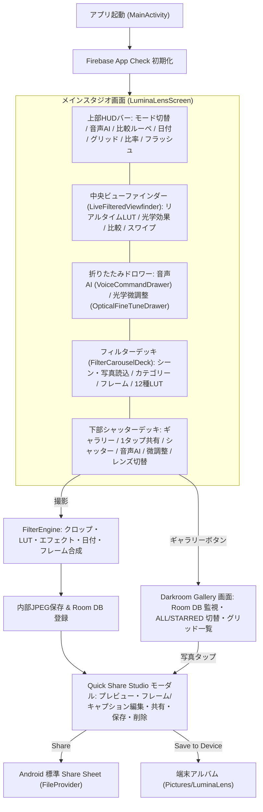
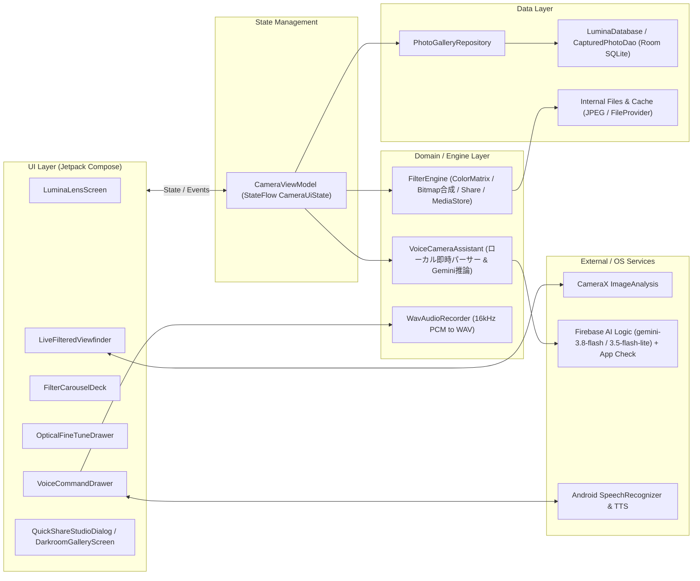
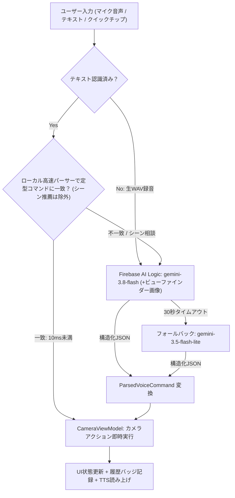

# LuminaLens (`SnapLens`)

> **「撮ったあとに加工する」から、「ファインダーの中で作品が完成する」体験へ。**  
> リアルタイムLUTカラーグレーディング、光学エフェクト、音声AIカメラ操作（Gemini Live Voice Camera OS）、ビフォーアフター比較ルーペ、フレーム書き出し＆ワンタップ共有を統合した Android 向けカメラスタジオアプリ。

---

## 1. プロダクト概要（Product Vision）

**LuminaLens**（リポジトリ名：`SnapLens`）は、モバイルカメラ撮影とフィルム／シネマ調のカラーグレーディングをシームレスに融合するプロダクトです。

従来のモバイル写真体験では「撮影 → 別アプリへ移動 → フィルター加工 → 枠付け → SNS共有」という分断されたステップが発生していました。LuminaLens はこれらを **単一の暗室（Darkroom）スタジオ体験** に統合し、以下の価値を提供します。

- **ファインダー内でのリアルタイム完成プレビュー**: 12種類の光学LUTと8項目の細密パラメータを60fps相当でライブ適用し、撮影前に仕上がりを確定できます。
- **ハンズフリー＆シーン最適化の音声AI操作**: 「写真を撮って」「サイバーパンク風にして」「このシーンに合うフィルターにして」といった自然な日本語・英語の指示でカメラを自在に操作できます。
- **ゼロフリクションな体験開始**: カメラ権限がない状態や実機カメラが使えない環境でも、内蔵HDRテストシーン（Studio Canvas）や端末写真のインポートですぐに全機能を試せます。
- **撮影から共有までの最短導線**: 撮影直後のモーダルまたはローカルギャラリーから、フレーム・キャプションを整えてワンタップでSNS共有・端末保存が完了します。

### 想定ターゲットとユースケース

| ターゲットペルソナ | 主な課題 | LuminaLens の提供価値 |
| :--- | :--- | :--- |
| **SNS・ストリートフォト愛好家** | 撮影後の色味編集やフレーム加工に手間がかかる | 撮影時点でLUT・粒子・日付スタンプ・ポラロイド／シネマ枠を確定し即共有 |
| **フィルム・シネマ表現にこだわるクリエイター** | スマホ標準カメラでは画一的な写りになる | 4×5カラーマトリクス＋光学オーバーレイ＋8項目パラメータ＋分割比較ルーペで精密調整 |
| **自撮り・三脚撮影・片手撮影ユーザー** | シャッター操作や設定変更のたびに構図が崩れる | 音声AIでフィルター変更・露出調整・シャッター・共有までハンズフリー操作 |

---

## 2. 主要機能一覧（Core Features）

### 2.1 デュアルビューファインダー（`LIVE OPTICS` / `STUDIO CANVAS`）
- **LIVE OPTICS（リアルタイムカメラ）**: CameraX（`ImageAnalysis` / RGBA_8888）によるライブ映像にリアルタイムでカラーグレーディングと光学エフェクトを描画。
  - イン／アウトカメラ切替（フロントカメラ時は自動ミラー反転）
  - フラッシュ4モード切替（`OFF` / `AUTO` / `ON` / `TORCH`）
  - アスペクト比3種（`3:4` / `1:1` / `9:16`）
  - 三分割構図グリッド＆中央クロスヘア表示切替
  - タップフォーカスレティクル演出＆左右スワイプでのフィルター順次切替
- **STUDIO CANVAS（バーチャル光学スタジオ）**:
  - プロシージャル生成された高ダイナミックレンジの検証用4シーン（`Shinjuku Rain` / `Solstice Coast` / `Prism Studio` / `Dolomite Blue`）を内蔵。
  - Android Photo Picker（ストレージ権限不要）で端末内の写真を読み込み、そのままリアルタイムグレーディング＆書き出しが可能。

### 2.2 12種類の光学LUTフィルターカタログ & お気に入り
5つの表現カテゴリー（＋ `All LUTs` / `Starred`）に分類された12種類のプリセットを搭載。各フィルターは **20要素（4×5）のカラーマトリクス** に加え、デュアルトーン・グラデーションオーバーレイと固有のデフォルト光学値（ビネット・粒子・ライトリーク）を持ちます。

| カテゴリー | フィルター名 | コード | 特徴・表現テイスト |
| :--- | :--- | :--- | :--- |
| **Analog 35mm** | Optical Zero | `STD 00` | ニュートラルな標準光学キャリブレーション |
| **Analog 35mm** | Portra Gold 400 *(初期選択)* | `GOLD 400` | 温かみのある黄金ハイライトと柔らかな肌色 |
| **Analog 35mm** | Velvia Emerald | `VELVIA 50` | リバーサルフィルム調の高彩度な緑・青と高コントラスト |
| **Cinema Grade** | Anamorphic Teal | `CINE T&O` | 映画的なティール＆オレンジのスプリットトーニング |
| **Cinema Grade** | Tungsten 800T | `CINE 800T` | 夜景向けタングステンフィルム調のクールな暗部とハレーション |
| **Cinema Grade** | Silver Retention | `BLEACH 99` | 銀残し（ブリーチバイパス）風の硬質な低彩度・高コントラスト |
| **Cyber & Neon** | Neon Dystopia | `CYBER 88` | マゼンタ×シアンのネオン夜景向けサイバーパンク調 |
| **Cyber & Neon** | Aerochrome Infrared | `IR AERO` | 赤外線フィルム風の幻想的なクリムゾン発色 |
| **B&W Darkroom** | Silver Halide B&W | `NOIR M11` | 深い黒と銀塩ハイライトの高コントラストモノクロ |
| **B&W Darkroom** | Platinum Palladium | `PLATINUM` | 19世紀のプラチナプリント風アーカイブセピア調 |
| **Light Leaks** | Solaris Prism Leak | `SOLAR 77` | 強いアンバー光漏れと持ち上げたマットシャドウ |
| **Light Leaks** | Instant SX-70 | `SX-70` | 淡い黒浮きと柔らかな黄味を帯びたインスタントフィルム調 |

### 2.3 リアルタイム光学ファインチューニング（8パラメータ）
折りたたみ式ドロワーから、選択中LUTをベースに以下の8項目をライブ調整・ワンタップリセットできます。

| タグ | パラメータ | 調整範囲 | 役割 |
| :--- | :--- | :--- | :--- |
| `LUT` | Filter LUT Strength | `0%` 〜 `100%` | ベースLUTの適用強度（単位行列との線形補間） |
| `EV` | Optical Exposure | `-0.6` 〜 `+0.6` | 光学露出補正 |
| `CTR` | Tone Contrast | `-0.4` 〜 `+0.7` | トーンコントラスト |
| `WB` | Color Temp | `-0.8` 〜 `+0.8` | 色温度（暖色／寒色バランス） |
| `SAT` | Vibrance | `-1.0` 〜 `+0.8` | 彩度・鮮やかさ |
| `VIG` | Lens Vignette | `0%` 〜 `100%` | 周辺減光（放射状ビネット） |
| `GRN` | 35mm Silver Grain | `0%` 〜 `100%` | 35mm銀塩フィルム粒子 |
| `LEAK` | Prism Light Leak | `0%` 〜 `100%` | プリズム光漏れエフェクト |

### 2.4 ビフォーアフター分割比較ルーペ（Split Compare Loupe）
ビューファインダー上にドラッグ可能な境界線を表示し、左側に `ORIGINAL RAW`、右側にグレーディング適用後映像をリアルタイム比較（境界位置 8%〜92% で調整可能）。

### 2.5 Gemini Live Voice Camera OS（音声AIカメラアシスタント）
レスポンス速度と高度なマルチモーダル理解を両立するため、**ハイブリッド2層コマンド処理** を採用しています。

1. **ローカル高速パーサー（<10ms 即時実行）**:  
   「写真を撮って」「映画風のフィルターにして」「モノクロ＋ポラロイド枠にして」「明るくしてビネットを強くして」などの定型・複合指示をネットワーク待ちゼロで即実行。
2. **Firebase AI Logic マルチモーダル推論（Gemini）**:  
   「このシーンに合うフィルターにして」といった視覚判断が必要な要求や生WAV音声クリップ（16kHz / 16-bit モノラル、最大5秒）を、ファインダー画像（192px幅サムネイル）とともに **`gemini-3.8-flash`** へ送信（30秒タイムアウト時は **`gemini-3.5-flash-lite`** へ自動フォールバック）。5フィールドの軽量構造化JSONスキーマで安全にカメラアクションへ変換します。

- **多彩な入力手段**: Android `SpeechRecognizer`（利用不可環境では `WavAudioRecorder` へ自動フォールバック）、テキスト直接入力、10種類のワンタップ・クイック音声チップ。
- **対応アクション（17種）**: 撮影、フィルター指定／次・前切替、レンズ切替、フラッシュ設定、フレーム変更、アスペクト比変更、露出／色温度／ビネット／粒子等の微調整、比較ルーペ・グリッド・日付スタンプ切替、ギャラリー開閉、最新写真の共有／端末保存、調整リセット。
- **音声フィードバック**: Android `TextToSpeech`（TTS）による日本語／英語の応答読み上げ（ON/OFF切替可能）と、直近の対話・実行アクションバッジ履歴の表示。

### 2.6 フレーム書き出し・レトロ日付スタンプ・Darkroomギャラリー
- **4種類のソーシャル書き出しフレーム**:
  - `RAW`（Full Bleed）: 枠なしフルブリード出力
  - `INSTAX`（Instant Film）: 温かみのある紙質調のポラロイド枠＋セリフ体キャプション＋LUT/ISO/日付署名
  - `CINE`（Anamorphic 2.35）: 上下シネマスコープ黒帯＋メタデータ＋キャプション／タイムコード
  - `EXIF`（Museum EXIF）: ダークマット額装＋アンバーアクセントライン＋EXIF仕様表記
- **レトロ35mmクォーツ日付スタンプ**: 右下に `'yy MM dd HH:mm • LUTコード` をオレンジ発光調で焼き込み可能（ON/OFF切替）。
- **Darkroom Gallery & クイック共有**:
  - 撮影した画像は内部ストレージ（`filesDir/captured_photos/`）に高画質JPEG（品質94%）保存し、メタデータとファイルパスを **Room SQLite** で永続管理（初回起動時にサンプル2作品を自動シード）。
  - ギャラリーは `ALL` / `STARRED` で絞り込み可能。各写真からワンタップで **Android標準Share Sheet（`FileProvider`経由）** 共有、**端末ギャラリー（`Pictures/LuminaLens` / MediaStore）** 保存、お気に入り切替、削除が行えます。

---

## 3. 画面構成とユーザーフロー（UX / Information Architecture）

UI全体は暗室とレンジファインダーカメラから着想を得たダークテーマ（`ObsidianBlack #090A0F` × `LeicaAmber #FFB300` × `OpticalCyan #00E5FF`）で統一され、見出し・本文に **Space Grotesk**、テレメトリ・パラメータ表示に **JetBrains Mono** を採用しています。



---

## 4. システム構成とアーキテクチャ（Architecture）

**MVVM + 単方向データフロー（Unidirectional Data Flow）** を採用し、UI・状態管理・画像処理／AIドメイン・データ永続化の責務を明確に分離しています。



### 音声AIコマンド処理フロー（ハイブリッドルーティング）



---

## 5. ディレクトリ構成（Project Structure）

```text
SnapLens/
├── metadata.json                           # プロダクトメタデータ（名前・概要・Geminiサーバーサイド連携定義）
├── .env.example                            # 環境変数ポリシー（Firebase App Check 利用のためクライアントAPIキー不要）
├── settings.gradle.kts                     # Gradle プロジェクト設定（rootProject.name = "LuminaLens"）
├── build.gradle.kts                        # ルート Gradle プラグイン定義
├── gradle/libs.versions.toml               # Version Catalog（依存関係・バージョン一元管理）
└── app/
    ├── build.gradle.kts                    # アプリモジュール設定（SDK・署名・Secrets・Google Services・依存関係）
    └── src/
        ├── main/
        │   ├── AndroidManifest.xml         # 権限宣言（INTERNET / CAMERA / RECORD_AUDIO）と FileProvider 定義
        │   ├── res/
        │   │   ├── font/                   # Space Grotesk / JetBrains Mono カスタムフォント
        │   │   ├── values/                 # strings.xml / colors.xml / themes.xml / firebase_applet_config.xml
        │   │   └── xml/                    # file_paths.xml（共有キャッシュ・撮影画像パス）ほか
        │   └── java/com/example/
        │       ├── MainActivity.kt         # エントリポイント（App Check初期化 → Edge-to-Edge Compose UI）
        │       ├── AppCheckHelper.kt       # Debug/Release 別の Firebase App Check プロバイダ構成
        │       ├── model/
        │       │   └── FilterModels.kt     # 12種LUTカタログ、8調整パラメータ、フレーム、シーン、撮影データモデル
        │       ├── domain/
        │       │   ├── FilterEngine.kt     # ColorMatrix合成、高解像度描画、フレーム焼き込み、スタジオシーン生成、共有/保存
        │       │   └── VoiceCameraAssistant.kt # ローカル高速パーサー、Gemini構造化推論、WAV録音エンコーダ
        │       ├── data/
        │       │   ├── LuminaDatabase.kt   # Room データベース定義（lumina_darkroom_gallery.db）
        │       │   ├── CapturedPhotoEntity.kt # Room Entity & Domain 相互マッパー
        │       │   ├── CapturedPhotoDao.kt # SQLite クエリ定義（Flow監視・Upsert・お気に入り・削除）
        │       │   └── PhotoGalleryRepository.kt # DB操作と内部画像ファイル削除を統合するリポジトリ
        │       └── ui/
        │           ├── CameraViewModel.kt  # アプリ全体の状態管理（CameraUiState）とビジネスロジック連携
        │           ├── LuminaLensScreen.kt # メイン画面（Top HUD / Viewfinder / Drawers / Deck / Shutter）
        │           ├── components/
        │           │   ├── LiveFilteredViewfinder.kt       # CameraX連携・リアルタイム描画・比較ルーペ・ジェスチャー
        │           │   ├── FilterCarouselDeck.kt           # シーン選択・カテゴリータブ・フレーム切替・LUTカルーセル
        │           │   ├── OpticalFineTuneSheet.kt         # 8パラメータ調整スライダー＆リセットドロワー
        │           │   ├── VoiceCommandHudSheet.kt         # 音声入力UI・波形アニメ・クイックチップ・TTS・履歴
        │           │   └── QuickShareAndGalleryModals.kt   # 撮影後書き出しモーダル＆Darkroomギャラリー画面
        │           └── theme/              # Color.kt / Theme.kt / Type.kt（暗室デザインシステム）
        ├── test/java/com/example/
        │   ├── ExampleUnitTest.kt          # LUTカタログ・Roomマッピング・Repository・ViewModel の単体テスト
        │   └── ExampleRobolectricTest.kt   # 画像レンダリングパイプライン・音声JSONパーサーの Robolectric テスト
        └── androidTest/java/com/example/
            └── ExampleInstrumentedTest.kt  # 計装テストテンプレート
```

---

## 6. 技術スタック・動作要件（Tech Stack & Requirements）

| 項目 | 内容 |
| :--- | :--- |
| **プラットフォーム** | Android（`minSdk 24` / `targetSdk 36` / `compileSdk 36.1`） |
| **アプリケーションID** | `com.aistudio.luminalens.vqxrtk` |
| **言語・ビルド** | Kotlin `2.2.10` / Java `11` / Android Gradle Plugin `9.1.1` / KSP `2.3.5` |
| **UIフレームワーク** | Jetpack Compose（BOM `2024.09.00`） / Material 3 / Coil Compose `2.7.0` |
| **カメラ** | AndroidX CameraX `1.5.0`（`camera-core`, `camera-camera2`, `camera-lifecycle`, `camera-view`） |
| **ローカル永続化** | AndroidX Room `2.7.0`（SQLite + Coroutines Flow） |
| **生成AI・セキュリティ** | Firebase BoM `34.17.0` / **Firebase AI Logic**（`firebase-ai`） / **Firebase App Check**（Debug / reCAPTCHA） |
| **非同期処理** | Kotlin Coroutines `1.10.2` / Lifecycle ViewModel & Runtime Compose `2.8.7` |
| **テスト** | JUnit 4 / Kotlin Coroutines Test / Robolectric `4.16.1` / Compose UI Test |

### 権限とプライバシー設計
- `CAMERA`（任意）: ライブカメラ映像の取得に使用。未許可でも **STUDIO CANVAS** モードで全フィルター・調整機能を利用可能。
- `RECORD_AUDIO`（任意）: 音声コマンド入力に使用。未許可でもテキスト入力・クイック音声チップからAIコマンドを実行可能。
- `INTERNET`: Firebase AI Logic（Gemini）との通信に使用。
- **ストレージ権限不要**: 写真インポートは Android Photo Picker（`PickVisualMedia`）、書き出し保存は Scoped Storage（`MediaStore`）、共有は `FileProvider` を利用し、過剰なストレージ権限を要求しません。
- **APIキーレス構成**: クライアント側に `GEMINI_API_KEY` を埋め込まず、Firebase AI Logic ＋ Firebase App Check 経由で安全に推論を行います。

---

## 7. セットアップ・ビルド・テスト手順（Getting Started）

### 前提条件
- Android Studio（AGP 9.x / Compile SDK 36 対応版）
- JDK 11 以上
- （Gemini 音声AI機能を利用する場合）Firebase プロジェクトの `google-services.json` を `app/` 配下に配置（未配置でもビルド自体は警告のみで続行するよう設定されています）

### Firebase App Check の設定
- **Debug ビルド**: `AppCheckHelper` が起動 Intent の `FIREBASE_APPCHECK_DEBUG_TOKEN` extra を読み込み、`DebugAppCheckProviderFactory` を登録します。
- **Release ビルド**: `app/src/main/res/values/firebase_applet_config.xml` の `recaptcha_site_key` を参照し、`RecaptchaAppCheckProviderFactory` を登録します。

### ビルド & テストコマンド

```bash
# Debug APK のビルド
./gradlew assembleDebug

# ローカル単体テスト & Robolectric テストの実行
./gradlew testDebugUnitTest

# 接続デバイス / エミュレータでの計装テスト実行
./gradlew connectedDebugAndroidTest
```

### テストでカバーされている主要品質観点
- **単体テスト（`ExampleUnitTest`）**: 12種LUTの20要素マトリクス整合性、Room Entity ⇔ Domain のマッピング精度、`PhotoGalleryRepository` の CRUD・お気に入り更新、`CameraViewModel` のフィルター・パラメータ・比較ルーペ状態遷移。
- **Robolectric テスト（`ExampleRobolectricTest`）**: リソース検証、スタジオシーン生成〜カラーマトリクス合成〜ポラロイドフレーム書き出しのレンダリングパイプライン、Gemini 構造化JSONコマンドのパース検証。

---

## 8. 現状スコープと今後のプロダクトロードマップ案（PO Notes）

現在のバージョン（`v1.0`）は、リアルタイムLUT撮影・光学調整・音声AI操作・ローカルRoomギャラリー・即時共有のコア体験を一貫して動作する状態まで構築しています。今後のフェーズでプロダクト価値をさらに高めるためのバックログ候補は以下の通りです。

1. **実写撮影写真の非破壊再編集対応**  
   - 現状、撮影後モーダルでのフレーム・キャプション変更（`updatePhotoFrameAndCaption`）は現在選択中のスタジオシーン画像をもとに再レンダリングする挙動となっています。撮影時の未加工（RAW）フレームをキャッシュ／紐付け保持することで、実写カメラ撮影写真でもフレーム・キャプションを劣化なく再編集できるように改善予定。
2. **お気に入りLUT・ユーザー設定の永続化**  
   - 現状メモリ上（`CameraUiState`）で保持しているお気に入りフィルター（`favoriteFilterIds`）やグリッド／日付スタンプ設定を `DataStore Preferences` へ保存し、アプリ再起動後もユーザー好みのスタジオ環境を維持。
3. **プロダクト名・パッケージ名の統一**  
   - リポジトリ名（`SnapLens`）・アプリ表示名（`LuminaLens`）・内部パッケージ（`com.example`）のネーミングを正式リリースブランドに合わせて整理。
4. **クラウド同期＆カスタムLUTレシピ共有（拡張余地）**  
   - `app/build.gradle.kts` に準備済みの Firebase Auth / Firestore 依存関係を活用し、ユーザー独自の光学調整プリセット（レシピ）のクラウド保存やコミュニティ共有へ展開可能。
5. **UI計装テストの拡充**  
   - 各主要コンポーネントに付与済みの `testTag` を活用し、撮影〜音声コマンド〜ギャラリー〜共有までのE2E UIテストを自動化。
